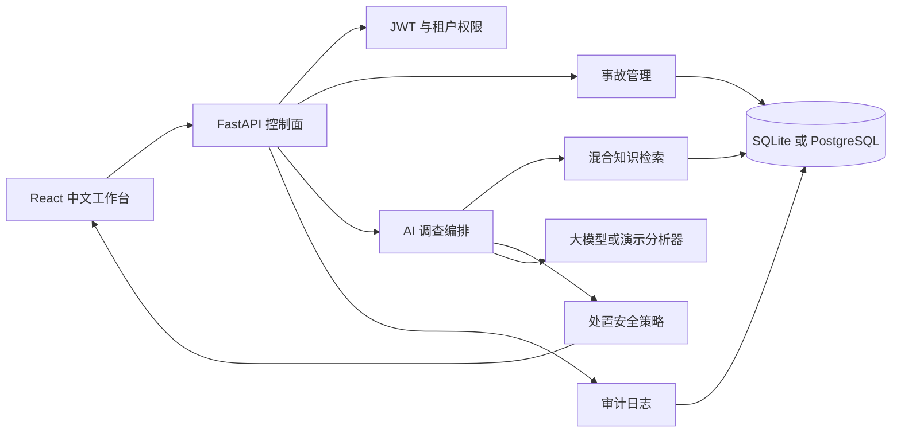

# OpsMind AI

[](https://github.com/VKanee/opsmind-ai/actions/workflows/ci.yml)
[](LICENSE)
[](apps/api/pyproject.toml)
[](apps/web/package.json)

OpsMind AI 是一个面向企业运维团队的事故智能平台。它将事故管理、知识检索、
AI 根因分析、人工审批、权限隔离、审计日志和效果评测整合成一条完整工作流。

这个项目不是通用聊天机器人，也不是只会生成一段文字的工具。它要解决的问题是：
线上系统发生故障时，值班人员能否快速找到相关手册、关联历史事故、形成可验证的
故障假设，并在不绕过审批和审计的前提下采取下一步行动。

如果只想先用通俗语言了解项目，请阅读
[项目说明](docs/PROJECT_OVERVIEW.zh-CN.md)。


## 项目是做什么的

生产事故发生以后，运维人员通常会同时面对以下问题：

- 告警、日志、监控、聊天记录和变更信息分散在多个系统中；
- 处置手册很长，值班人员需要在压力下快速找到真正相关的段落；
- AI 很容易给出看似合理但缺少证据支撑的故障原因；
- 回滚、限流、扩容等生产操作风险很高，不能由模型直接执行；
- 招聘方或管理者需要看到项目是否真的具备企业级工程能力。

OpsMind AI 的处理方式是：

1. 建立事故记录，并保存服务、等级、负责人、运行信号和持续时间。
2. 从经过验证的知识库中检索处置手册、服务依赖、历史复盘和制度规范。
3. 调用大模型或演示分析器生成故障假设，并为每条假设绑定证据。
4. 将中高风险处置建议自动送入人工审批队列。
5. 记录事故变更、AI 调查和审批决定的完整审计日志。
6. 使用固定评测集检查检索命中率、证据引用和安全策略。

## 可以使用哪些功能

### 事故管理

- 支持 SEV1 至 SEV4 事故等级。
- 支持待处理、调查中、已缓解、已解决四种状态。
- 记录服务名称、负责人、标签、运行信号、开始时间和解决时间。
- 查看进行中事故、严重程度分布、活动服务和待审批数量。

### AI 事故调查

- 将事故描述和运行信号用于知识检索。
- 使用中文分词、词法匹配和本地向量相似度进行混合检索。
- 自动生成按置信度排序的故障假设。
- 每条假设和处置建议都关联证据片段。
- 显示证据来源、匹配分数和智能体执行过程。
- 支持 OpenAI 兼容模型接口。
- 未配置模型密钥时使用确定性演示分析器，方便本地展示和自动化测试。

### 知识库

- 支持处置手册、复盘报告、服务文档和制度规范。
- 管理员可以新增知识内容。
- 系统会自动切分文档并建立检索索引。
- 支持中文和英文技术术语混合检索。

### 审批和治理

- 支持管理员、响应者、只读用户三种角色。
- 所有组织数据按租户隔离。
- 中高风险处置建议必须经过人工审批。
- 审批可以批准或驳回，并记录审批说明。
- 重复审批会被拒绝，避免状态被反复修改。
- 当前处置执行器是模拟模式，不会真正重启数据库或修改云资源。

### 工程能力

- FastAPI、SQLAlchemy 2、Pydantic 2、Alembic。
- React 19、TypeScript、Vite。
- PostgreSQL 生产配置和 SQLite 本地默认配置。
- Prometheus 指标、健康检查和请求耗时响应头。
- Docker Compose 一键启动。
- GitHub Actions 执行 API、前端、容器和浏览器测试。
- 5 个事故场景的 Golden Evaluation。

## 适合哪些人使用

### SRE 和值班工程师

在故障处理期间快速查找处置手册、关联历史事故并形成有证据支撑的判断。

### DevOps 和平台工程团队

将内部运行手册、服务说明和复盘资料整理成可检索的企业知识资产。

### 技术管理者和事故指挥者

查看待审批操作、事故等级分布、调查记录和审计日志，确认生产变更没有被模型绕过。

### AIOps 和 LLMOps 团队

将它作为企业内部事故智能体的参考实现，继续接入监控、日志、工单、聊天机器人和
云平台执行器。

### 求职者和项目展示者

这个仓库展示了全栈开发、权限控制、数据建模、RAG、模型调用、评测、容器化、CI
和前端设计能力，可以作为 GitHub 实战项目展示。

## 项目不能做什么

当前版本是“生产级参考实现”，不是已经接入真实企业的完整商业产品：

- 不会自动执行基础设施命令。
- 不替代 Prometheus、Grafana、PagerDuty 或企业现有告警系统。
- 没有预置真实企业身份认证，当前使用演示 JWT 账号。
- 知识检索仍采用应用层混合检索，大规模场景需要 pgvector 或专用向量数据库。
- AI 输出需要人工复核，不能直接作为生产决策。

## 快速运行

### 方式一：Docker 启动，推荐

前提：已安装 Docker Desktop。启动脚本会在 Docker 未运行时自动启动它。

在仓库根目录执行：

```powershell
.\scripts\start.ps1
```

或者直接执行：

```powershell
docker compose up -d --build
```

浏览器打开：

```text
http://localhost:8080
```

中文 API 使用说明：

```text
http://localhost:8080/docs
```

开发者交互式 Swagger 调试界面：

```text
http://localhost:8080/swagger
```

查看状态：

```powershell
.\scripts\status.ps1
```

停止但保留数据：

```powershell
.\scripts\stop.ps1
```

重新启动：

```powershell
docker compose start
```

如果连 Docker Desktop 也要关闭：

```powershell
.\scripts\quit-docker.ps1
```

项目容器停止后，Docker Desktop 不需要继续运行。关闭 Docker Desktop 可以减少内存占用，
但镜像、构建缓存和数据库数据仍会保存在磁盘中。

完全删除演示数据库并重新初始化：

```powershell
docker compose down -v
.\scripts\start.ps1
```

注意：`docker compose down -v` 会删除 PostgreSQL 数据卷。当前演示数据可以重建，
但生产环境禁止直接使用这个命令。

### Docker 占用磁盘的说明

Docker Desktop 在 Windows 中通常把镜像、构建缓存和数据库卷保存在 WSL 虚拟磁盘中，
默认位置类似：

```text
C:\Users\<用户名>\AppData\Local\Docker\wsl\disk\docker_data.vhdx
```

当前项目实测占用大致为：

- Docker 镜像：约 809 MB。
- Docker 构建缓存：约 1.24 GB。
- PostgreSQL 演示数据卷：约 49 MB。
- WSL 虚拟磁盘文件已分配空间：约 3.38 GB。

项目源码、Python 虚拟环境和前端依赖位于仓库所在的 E 盘，不在 C 盘。C 盘空间变化还可能
包括 Windows 更新缓存。

查看 Docker 占用：

```powershell
docker system df
```

清理可以安全删除的构建缓存：

```powershell
.\scripts\clean-build-cache.ps1
```

清理后 Docker 报告的逻辑占用会下降，但 WSL 虚拟磁盘文件不一定会立即缩小。不要在不了解
影响时执行 `docker system prune -a --volumes`，它可能删除其他 Docker 项目的镜像或数据。

### 方式二：本地源码开发

启动：

```powershell
.\scripts\dev.ps1
```

停止：

```powershell
.\scripts\dev-stop.ps1
```

本地开发地址为 `http://localhost:5173`，API 地址为 `http://localhost:8000`。

## 演示账号

| 角色 | 邮箱 | 密码 |
| --- | --- | --- |
| 管理员 | `admin@opsmind.local` | `OpsMind!2026` |
| 响应者 | `responder@opsmind.local` | `OpsMind!2026` |
| 只读用户 | `viewer@opsmind.local` | `OpsMind!2026` |

这些账号只用于本地演示。部署到共享环境前必须修改密码和 JWT 密钥。

## 别人如何打开这个项目

GitHub 仓库保存的是源代码，不会自动变成一个公网网站。别人拿到 GitHub 地址后，
可以选择以下三种方式。

### 1. 对方在自己的电脑运行

对方需要安装 Git 和 Docker Desktop，然后执行：

```bash
git clone https://github.com/VKanee/opsmind-ai.git
cd opsmind-ai
docker compose up -d --build
```

随后访问 `http://localhost:8080`。

### 2. 在同一个局域网访问

你的电脑启动 Docker 后，Docker 已经监听 `0.0.0.0:8080`。同网络的同事可以使用
你的局域网 IP 访问：

```text
http://你的电脑IP:8080
```

Windows 可以通过以下命令查看 IP：

```powershell
ipconfig
```

如果对方无法访问，需要允许 Windows 防火墙的 8080 端口。这种方式只适合内部演示，
不要直接暴露到公网。

### 3. 部署到云服务器

如果希望别人通过一个正式网址访问，需要把项目部署到云服务器或 Kubernetes 集群。
推荐流程：

1. 准备一台安装 Docker 的 Linux 云服务器。
2. 安装 Docker Compose。
3. 克隆仓库并修改 `.env` 中的 JWT 密钥和演示密码。
4. 执行 `docker compose up -d --build`。
5. 使用 Caddy、Nginx 或云负载均衡配置 HTTPS 和域名。
6. 只开放 80、443，避免直接公开数据库端口。

仓库提供了 `deploy/Caddyfile.example` 和
[中文部署指南](docs/USAGE.zh-CN.md)。正式部署前还应接入企业 OIDC、关闭公开演示
账号、增加限流和备份策略。

如果只是临时演示，可以使用 Cloudflare Tunnel 或 ngrok 将本地 8080 端口临时映射
到公网。这类方式只适合短时演示，不适合承载真实企业数据。

## 项目结构

```text
apps/api/            FastAPI 后端、领域逻辑、测试和评测
apps/web/            React 中文运维工作台
docs/                架构、部署、评测、威胁模型和路线图
deploy/              公网反向代理示例
scripts/             启动、停止、测试和开发脚本
.github/workflows/   GitHub Actions 持续集成
```

## 核心架构



详细说明见 [架构文档](docs/ARCHITECTURE.md)、[威胁模型](docs/THREAT_MODEL.md)
和 [评测说明](docs/EVALUATION.md)。

## 配置项

| 环境变量 | 作用 | 默认值 |
| --- | --- | --- |
| `OPSMIND_DATABASE_URL` | 数据库连接地址 | 本地 SQLite |
| `OPSMIND_JWT_SECRET` | JWT 签名密钥 | 开发环境占位值 |
| `OPSMIND_SEED_DEMO_DATA` | 是否初始化演示数据 | `true` |
| `OPSMIND_DEMO_USER_PASSWORD` | 演示账号密码 | `OpsMind!2026` |
| `OPSMIND_LLM_MODE` | `demo` 或 `openai_compatible` | `demo` |
| `OPSMIND_LLM_BASE_URL` | OpenAI 兼容接口地址 | OpenAI |
| `OPSMIND_LLM_API_KEY` | 模型接口密钥 | 空 |
| `OPSMIND_LLM_MODEL` | 模型名称 | `gpt-4.1-mini` |
| `VITE_API_URL` | 前端 API 地址 | 本地 API |

完整模板见 [.env.example](.env.example)。

## 验证项目

一键验证：

```powershell
.\scripts\test.ps1
```

也可以分别执行：

```powershell
cd apps/api
.\.venv\Scripts\pytest.exe
.\.venv\Scripts\python.exe -m app.evaluation

cd apps/web
npm test
npm run build
```

当前基线：

- 后端 18 个测试通过。
- 前端 3 个测试通过。
- 5 个 Golden Evaluation 场景全部通过。
- Playwright 浏览器测试通过。
- Docker API、Web、PostgreSQL 全链路启动通过。
- GitHub Actions 四组检查通过。

## 后续路线

下一阶段建议按以下顺序扩展：

1. 接入企业 OIDC 登录和用户管理。
2. 使用 PostgreSQL + pgvector 替换应用层向量扫描。
3. 接入 Grafana、PagerDuty、Slack、企业微信或钉钉。
4. 增加后台任务队列，支持长时间模型调用和知识文档解析。
5. 增加白名单执行器、幂等键、双人审批和回滚验证。
6. 增加真实的检索召回率、引用准确率和人工采纳率评测。

详细计划见 [路线图](docs/ROADMAP.md)。

## 许可证

Apache License 2.0，详见 [LICENSE](LICENSE)。
