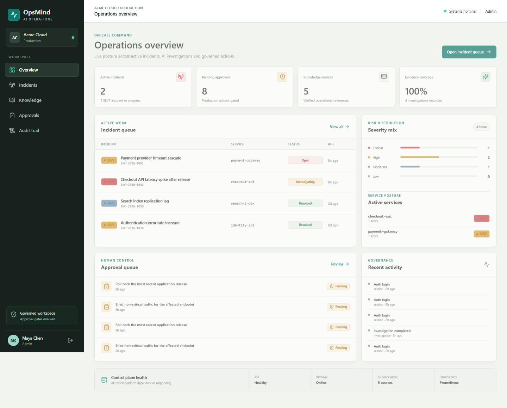
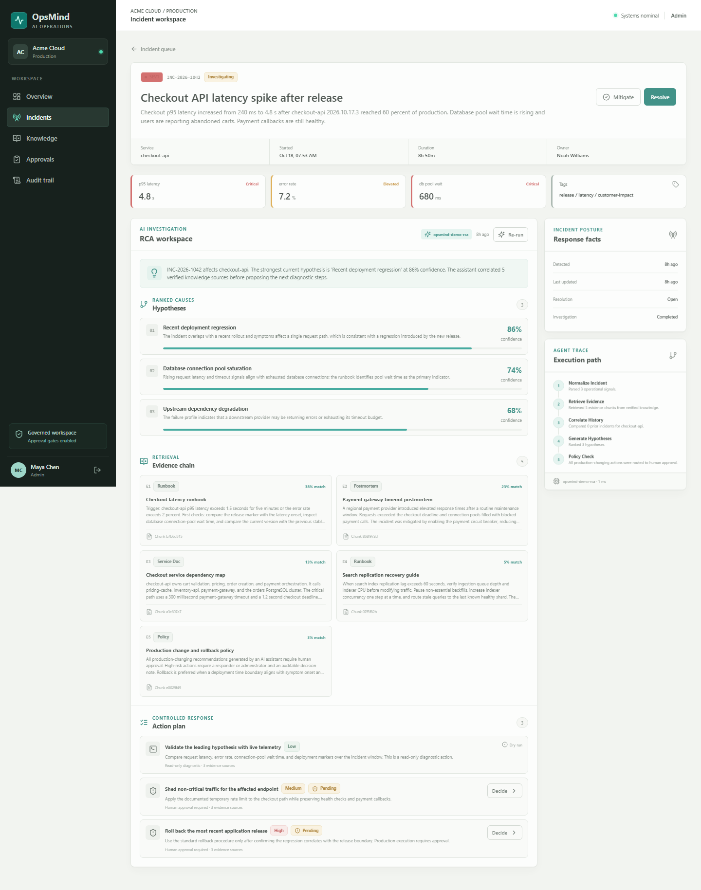
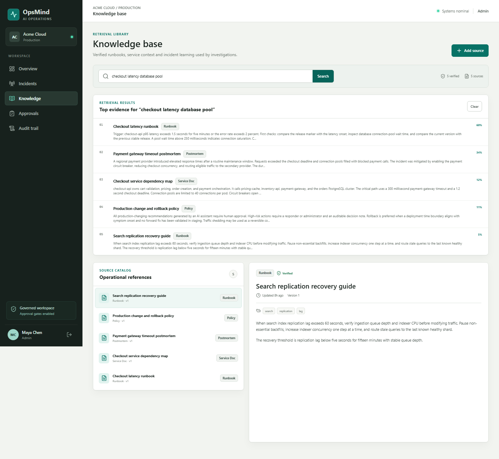
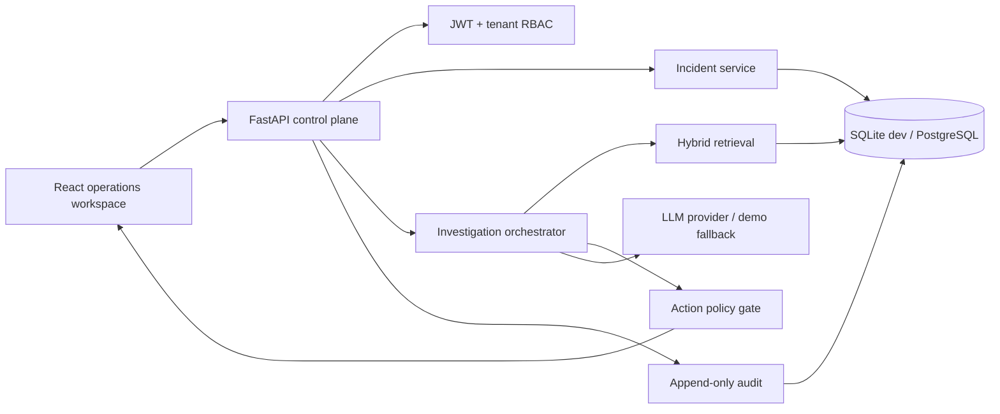

# OpsMind AI

[](https://github.com/VKanee/opsmind-ai/actions/workflows/ci.yml)
[](LICENSE)
[](apps/api/pyproject.toml)
[](apps/web/package.json)

OpsMind AI is an enterprise incident intelligence workspace. It combines
retrieval-augmented analysis, operational signals, evidence-backed root-cause
hypotheses, human approval gates, RBAC, and append-only audit events in one
working product.

The project is an independent implementation. It does not fork or copy source
code from another AI operations platform. See [Landscape](docs/LANDSCAPE.md)
for the product patterns reviewed during design.



## Why This Project Exists

Most AI incident tools stop at a chat interface. Production incident response
requires more:

- every diagnosis must cite the operational evidence that supports it;
- production-changing recommendations need human approval;
- role boundaries and tenant isolation cannot rely on prompt instructions;
- every human and AI action needs an auditable record;
- model quality must be measured against a stable regression suite;
- the system must remain useful when an external model is unavailable.

OpsMind AI treats those as product requirements, not future enhancements.

## Capabilities

### Incident command

- SEV1-SEV4 incident lifecycle with service, owner, tags, duration, and signal
  context
- role-aware incident creation and state transitions
- operational dashboard with severity mix, service posture, approval load,
  knowledge coverage, and recent activity

### Evidence-backed AI investigation

- versioned operational documents split into cited retrieval chunks
- deterministic local embeddings and hybrid lexical/vector ranking
- multi-step investigation trace: normalize, retrieve, correlate, hypothesize,
  policy check
- ranked root-cause hypotheses with confidence and evidence references
- OpenAI-compatible model adapter with a deterministic fallback for local demos
  and model outages

### Governance and safety

- JWT authentication with organization-scoped RBAC (`admin`, `responder`,
  `viewer`)
- medium- and high-risk actions automatically routed to a human approval queue
- action execution is simulation-only in this reference build; no infrastructure
  command adapter is enabled
- append-only audit trail for login, incident changes, investigations, and
  approval decisions
- tenant-scoped queries across all application resources

### Engineering quality

- FastAPI, SQLAlchemy 2, Pydantic 2, and a PostgreSQL-ready configuration
- React 19, TypeScript, Vite, and a responsive operations interface
- backend unit/integration tests plus frontend tests
- deterministic golden evaluation suite for retrieval, citations, and action
  policy
- Ruff, strict mypy, ESLint, TypeScript build, Docker, Alembic, and GitHub Actions
- structured request timing, Prometheus metrics, liveness, and readiness probes

## Screenshots

| Incident workspace | Knowledge retrieval |
| --- | --- |
|  |  |

## Architecture



The API owns policy enforcement, evidence assembly, approval state, and audit
records. The model produces structured recommendations but cannot bypass the
control plane. Detailed flows and trust boundaries are documented in
[Architecture](docs/ARCHITECTURE.md) and [Threat Model](docs/THREAT_MODEL.md).

## Quick Start

### Docker

```bash
docker compose up --build
```

Open `http://localhost:8080`.

### Local development

Backend:

```powershell
cd apps/api
python -m venv .venv
.\.venv\Scripts\python.exe -m pip install -e ".[dev]"
.\.venv\Scripts\python.exe -m uvicorn app.main:app --reload --port 8000
```

Frontend:

```powershell
cd apps/web
npm install
npm run dev
```

Open `http://localhost:5173`. Swagger is available at
`http://localhost:8000/docs`.

On macOS or Linux, use the equivalent `.venv/bin/...` paths.

### Demo accounts

| Role | Email | Password |
| --- | --- | --- |
| Admin | `admin@opsmind.local` | `OpsMind!2026` |
| Responder | `responder@opsmind.local` | `OpsMind!2026` |
| Viewer | `viewer@opsmind.local` | `OpsMind!2026` |

These accounts are created only for local demonstration. Set a new password and
JWT secret before any shared deployment.

## Validation

Backend:

```powershell
cd apps/api
.\.venv\Scripts\ruff.exe check app tests
.\.venv\Scripts\ruff.exe format --check app tests
.\.venv\Scripts\mypy.exe app
.\.venv\Scripts\pytest.exe
.\.venv\Scripts\python.exe -m app.evaluation
```

Frontend:

```powershell
cd apps/web
npm run lint
npm test
npm run build
```

The golden suite is intentionally deterministic so CI can detect regressions in
retrieval, citation coverage, and approval policy without requiring a paid model
endpoint. Production model quality should use versioned datasets and the
provider configured in `OPSMIND_LLM_*`.

## Configuration

Copy `.env.example` and set strong values for shared environments. Important
settings:

| Variable | Purpose | Default |
| --- | --- | --- |
| `OPSMIND_DATABASE_URL` | SQLAlchemy database URL | SQLite under `data/` |
| `OPSMIND_JWT_SECRET` | JWT signing key | development-only value |
| `OPSMIND_SEED_DEMO_DATA` | create demo organization and accounts | `true` |
| `OPSMIND_LLM_MODE` | `demo` or `openai_compatible` | `demo` |
| `OPSMIND_LLM_BASE_URL` | OpenAI-compatible API root | OpenAI |
| `OPSMIND_LLM_API_KEY` | provider key | empty |
| `OPSMIND_LLM_MODEL` | model identifier | `gpt-4.1-mini` |
| `VITE_API_URL` | frontend API prefix | `http://localhost:8000/api/v1` |

## Repository Layout

```text
apps/api/            FastAPI service, domain logic, tests, evaluation
apps/web/            React operations workspace
docs/                architecture, threat model, roadmap and screenshots
infra/               deployment-related configuration
.github/workflows/   CI and security automation
scripts/             local development and validation helpers
```

## Production Notes

This repository is a production-oriented reference system, not a claim that
every enterprise integration is complete. The current action engine records
simulated decisions and does not execute infrastructure commands. Before
production use:

- connect identity through an enterprise OIDC provider;
- move retrieval to PostgreSQL with pgvector, an approved embedding model, and
  index isolation per tenant;
- add a durable queue and worker for long-running model calls;
- implement signed, allowlisted execution adapters with idempotency keys;
- add secret management, backup/restore, retention, and data residency controls;
- replace demo authentication secrets and disable seeded data;
- run model, prompt, and safety evaluations in the deployment pipeline.

The staged delivery plan is in [Roadmap](docs/ROADMAP.md).

## License

Apache License 2.0. See [LICENSE](LICENSE).
