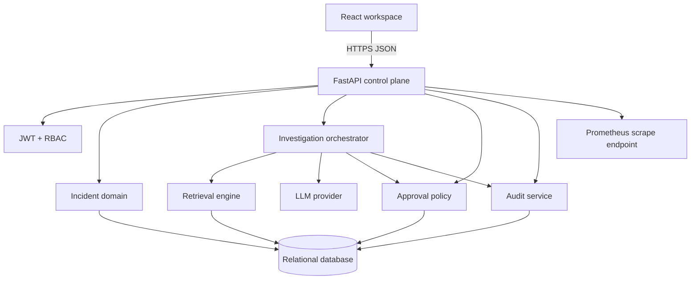
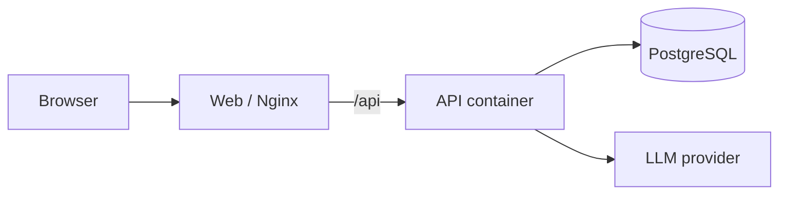

# Architecture

## System Context

OpsMind AI supports an on-call engineer from alert intake through a governed
response recommendation. The system deliberately separates probabilistic model
output from deterministic control logic.



## Request Flow

### Incident investigation

1. The responder requests an investigation for an incident.
2. The API resolves the authenticated user and enforces organization scope.
3. The orchestrator normalizes incident text and signals.
4. Hybrid retrieval ranks verified chunks using:
   - deterministic local embeddings and cosine similarity;
   - lexical token overlap;
   - document-title relevance.
5. The model adapter returns structured hypotheses and proposed actions.
6. The control plane verifies that every medium/high-risk action requires
   approval and that cited evidence belongs to the retrieved set.
7. Investigation, approval requests, and an audit event are persisted in one
   transaction.

### Approval

1. The approval row starts in `pending`.
2. A responder or admin records `approved` or `rejected` with a note.
3. The API updates the matching action state and writes an audit event.
4. Repeated decisions return `409 Conflict`.

No infrastructure command is executed in this build. The UI and API expose the
governance boundary that a future execution adapter must sit behind.

## Application Layers

```text
app/api/                 HTTP contracts and route composition
app/schemas.py           request/response validation
app/models.py            relational domain model
app/dependencies.py      authentication and role enforcement
app/services/retrieval   document indexing and evidence ranking
app/services/llm         structured analysis adapter and demo fallback
app/services/investigations
                         orchestration and approval policy
app/services/audit       append-only event creation
app/evaluation.py        golden regression runner
```

Business policy lives in services and dependencies, not in React components.
The browser does not decide whether an actor can mutate an incident or approve
an action.

## Data Model

Core entities:

- `Organization`: tenant boundary.
- `User`: organization-scoped identity and role.
- `Incident`: operational event and lifecycle state.
- `KnowledgeDocument` / `KnowledgeChunk`: source material and retrieval units.
- `Investigation`: immutable analytical output plus model metadata.
- `Approval`: human decision for a recommended action.
- `AuditEvent`: append-only action history.

All tenant-owned queries include `organization_id`. Public incident IDs and
internal UUIDs are separate so external references do not expose primary keys.

## Deployment Topology

The development profile uses SQLite for one-command startup. Docker Compose uses
PostgreSQL and runs the same API code with a separate web container.



Recommended production topology:

- managed PostgreSQL with encrypted storage and point-in-time recovery;
- pgvector or an approved vector index per tenant;
- Redis or a durable broker plus workers for model and ingestion jobs;
- central secret manager and OIDC identity provider;
- OpenTelemetry collector, centralized logs, and alerting;
- egress proxy with allowlisted model endpoints.

## Reliability

- `GET /health/live` does not depend on the database.
- `GET /health/ready` verifies database connectivity.
- `/metrics` exposes request count and latency histograms.
- Every HTTP response receives `x-request-id` and `x-process-time`.
- A malformed or unavailable external model falls back to deterministic
  analysis rather than blocking incident response.
- Database writes for an investigation, approvals, and audit event share a
  transaction.

## Known Boundaries

- Retrieval currently scans tenant chunks in application memory for portability.
  Production scale requires an indexed vector store or pgvector query adapter.
- Investigations run synchronously. Large evidence sets need a queue and
  progress events.
- Audit events are append-only by application design; database-level tamper
  evidence is a production hardening task.
- The deterministic demo analyzer is a resilience and test mechanism, not a
  substitute for model evaluation in production.
