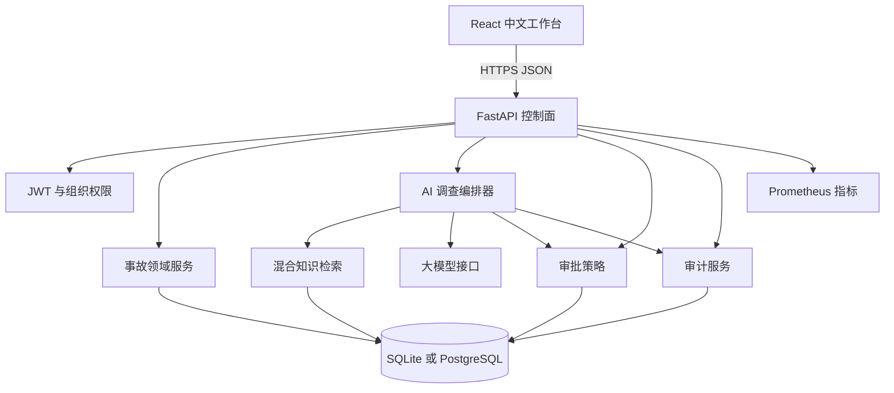
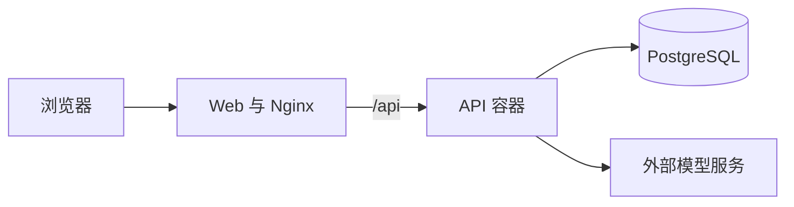

# 系统架构

## 系统目标

OpsMind AI 面向企业事故响应场景，将概率性的模型输出与确定性的安全控制分离。
模型可以提出故障假设和处置建议，但不能改变权限、切换租户、写审计日志或绕过审批。

## 系统上下文



## AI 调查流程

1. 响应者针对某个事故发起 AI 调查。
2. API 校验登录状态，并确认事故属于当前组织。
3. 编排器整理事故标题、描述、服务名称和运行信号。
4. 中文二元分词、词法匹配和本地向量相似度共同完成知识检索。
5. 模型生成结构化故障假设和处置建议。
6. 控制面过滤模型返回的无效证据 ID。
7. 所有中高风险生产变更强制设置 `approval_required=true`。
8. 调查记录、审批请求和审计事件在同一事务内写入数据库。

## 审批流程

1. 审批记录初始状态为“待审批”。
2. 响应者或管理员填写审批说明，并批准或驳回。
3. API 更新对应处置建议状态，同时写入审计日志。
4. 同一条审批不能重复决策，重复请求返回 `409 Conflict`。
5. 当前版本只记录审批结果，不执行真实基础设施命令。

## 应用分层

```text
app/api/                  HTTP 路由和接口组合
app/schemas.py            请求和响应校验
app/models.py             关系型领域模型
app/dependencies.py       登录校验和角色权限
app/services/retrieval    文档切分、索引和证据排序
app/services/llm          模型适配与演示分析器
app/services/investigations
                          AI 调查编排与审批策略
app/services/audit        审计事件写入
app/evaluation.py         固定评测集执行器
```

权限判断、审批策略和租户隔离全部位于后端。前端只负责展示和发起请求，不能决定
用户是否有权修改事故或批准生产操作。

## 数据模型

- `Organization`：租户边界。
- `User`：组织内的用户和角色。
- `Incident`：事故及生命周期状态。
- `KnowledgeDocument` / `KnowledgeChunk`：知识文档与检索片段。
- `Investigation`：AI 调查结果、证据、模型信息和执行轨迹。
- `Approval`：人工审批记录。
- `AuditEvent`：只追加的审计事件。

所有业务查询都会携带 `organization_id`。事故内部主键使用 UUID，对外展示使用独立
事故编号，避免泄露数据库主键。

## 部署结构

开发环境默认使用 SQLite，便于一条命令启动。Docker Compose 使用 PostgreSQL，
包含 API、Web 和数据库三个容器。



生产环境建议：

- 托管 PostgreSQL、加密存储和定时备份。
- 使用 pgvector 或独立向量数据库。
- 使用 Redis 或消息队列承载长时间调查任务。
- 使用企业 OIDC 或 SAML 登录。
- 使用 Secret Manager 管理密钥。
- 使用 OpenTelemetry 采集指标、日志和链路。
- 将模型出口限制在允许的域名和区域。

## 可靠性设计

- `/health/live` 不依赖数据库，用于存活检查。
- `/health/ready` 验证数据库连接，用于就绪检查。
- `/metrics` 提供请求数量和延迟直方图。
- 每个响应包含 `x-request-id` 和 `x-process-time`。
- 外部模型异常时回退到确定性分析器，不阻塞事故响应。
- 调查、审批和审计写入共享数据库事务。

## 当前边界

- 知识检索仍在应用层扫描当前组织的片段。大规模数据应使用 pgvector。
- 调查请求同步执行。接入大模型后应改为后台任务。
- 审计日志依靠应用层只追加设计，生产环境应增加哈希链或 WORM 存储。
- 演示分析器用于本地展示和回归测试，不能替代真实模型评测。
