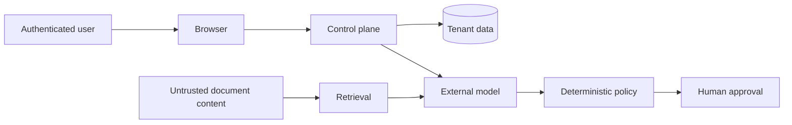

# Threat Model

## Assets

- incident descriptions and operational telemetry;
- runbooks, postmortems, and service documentation;
- model prompts and retrieved evidence;
- user identities, roles, and tenant membership;
- approval decisions and audit history;
- future infrastructure execution credentials.

## Trust Boundaries

The model is untrusted. It can propose actions and explanations, but it cannot
change roles, select another tenant, write audit events, or bypass approval.

## Threats and Controls

| Threat | Current control | Production hardening |
| --- | --- | --- |
| Cross-tenant data access | Every application query is scoped by JWT organization ID | PostgreSQL row-level security and automated isolation tests |
| Privilege escalation | Server-side role dependency on every write route | OIDC groups, short-lived tokens, step-up authentication |
| Prompt injection in runbooks | Structured output validation; policy checks outside the model | Content provenance, instruction-stripping, adversarial evaluation |
| Hallucinated diagnosis | Evidence IDs must reference retrieved chunks; UI shows citations | Claim-level entailment and model calibration |
| Unsafe remediation | Medium/high risk actions require human approval | Signed execution adapters, allowlists, idempotency, blast-radius limits |
| Model provider outage | Deterministic fallback analysis | Provider failover and circuit breakers |
| Token theft | Short configurable JWT lifetime and 401 invalidation | OIDC, secure cookies, rotation, device binding |
| Audit tampering | Append-only API design and restricted route surface | Hash chain, WORM storage, SIEM export |
| Sensitive data sent to model | Explicit provider boundary and local demo mode | DLP redaction, regional provider routing, field-level allowlists |
| Stolen API key | Key read from environment | Secret manager, per-environment keys, rotation, egress policy |
| Replay of approval | Approval state transition rejects repeated decisions | Nonce, expiration, strong re-authentication |

## Security Invariants

1. A user only receives resources from their organization.
2. Viewers cannot mutate incidents, investigations, knowledge, or approvals.
3. Only admins can ingest knowledge sources in the current build.
4. Medium- and high-risk model recommendations require human approval.
5. An approval can transition once from pending to approved or rejected.
6. Every investigation and approval decision creates an audit event.
7. Model output cannot directly execute production commands.

## Current Limitations

- Demo JWTs are stored in browser `localStorage`.
- Demo account passwords are shared for local evaluation.
- Audit events are not cryptographically chained.
- Rate limiting and account lockout are not implemented.
- Knowledge ingestion has no malware scan or file parser because source content
  is submitted as plain text.

These limitations are explicitly outside the current reference implementation
and must be resolved before exposure to real production data.
