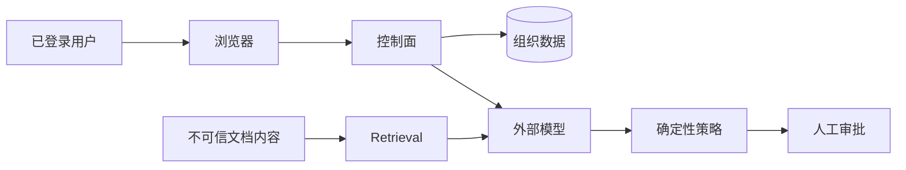

# 威胁模型

## 需要保护的资产

- 事故描述、日志和运行指标。
- 处置手册、复盘报告和服务文档。
- 模型提示词和检索证据。
- 用户身份、角色和组织成员关系。
- 审批记录和审计历史。
- 将来接入云平台后的执行凭据。

## 信任边界

模型被视为不可信组件。模型可以提出建议，但不能修改角色、访问其他租户、写审计日志
或绕过审批。

## 主要威胁与控制

| 威胁 | 当前控制 | 生产增强 |
| --- | --- | --- |
| 跨租户访问 | 所有查询按 JWT 中的组织 ID 过滤 | PostgreSQL 行级安全策略、隔离测试 |
| 越权操作 | 每个写接口执行服务端角色校验 | OIDC 用户组、短时令牌、强认证 |
| 文档提示词注入 | 结构化输出校验、模型外审批策略 | 内容来源标记、恶意指令检测 |
| 模型编造证据 | 过滤未检索到的证据 ID | 声明级溯源和可信度校准 |
| 高风险处置 | 中高风险操作强制人工审批 | 白名单执行器、双人审批、影响范围限制 |
| 模型服务中断 | 自动回退到演示分析器 | 多模型路由和熔断器 |
| 令牌泄露 | 可配置过期时间，401 后自动清理会话 | OIDC、安全 Cookie、令牌轮换 |
| 审计篡改 | 应用层只追加 | 哈希链、WORM 存储、SIEM 同步 |
| 敏感数据进入模型 | 明确外部模型边界和本地演示模式 | DLP 脱敏、区域路由、字段白名单 |
| 审批重放 | 已完成审批不能重复决策 | 随机数、过期时间、再次认证 |

## 必须保持的安全约束

1. 用户只能访问自己组织的数据。
2. 只读用户不能修改事故、知识、调查或审批。
3. 当前版本只有管理员可以新增知识文档。
4. 中高风险模型建议必须经过人工审批。
5. 审批只能从待审批状态转换一次。
6. AI 调查和审批决策必须产生审计事件。
7. 模型输出不能直接执行生产命令。

## 当前限制

- 演示 JWT 存储在浏览器 `localStorage`。
- 演示账号共用密码。
- 审计事件暂未使用哈希链。
- 尚未实现限流和账号锁定。
- 知识内容以纯文本提交，没有文件病毒扫描。

这些限制在接入真实生产数据前必须解决。
